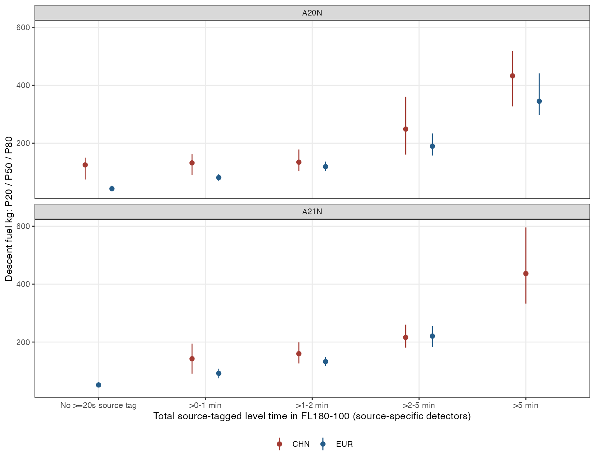
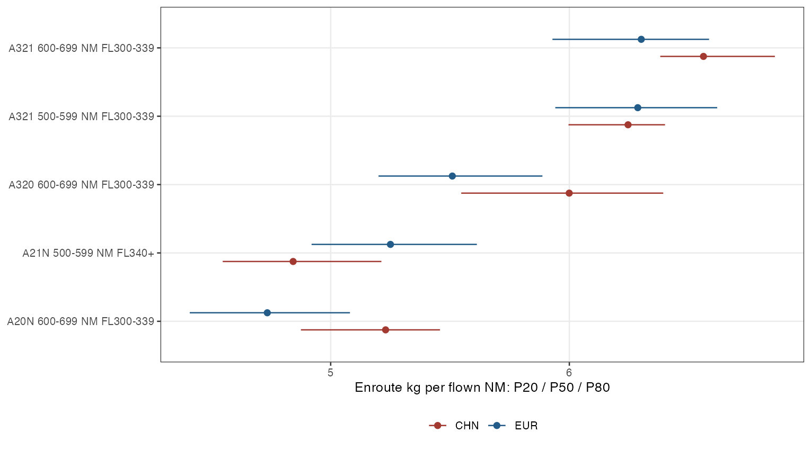
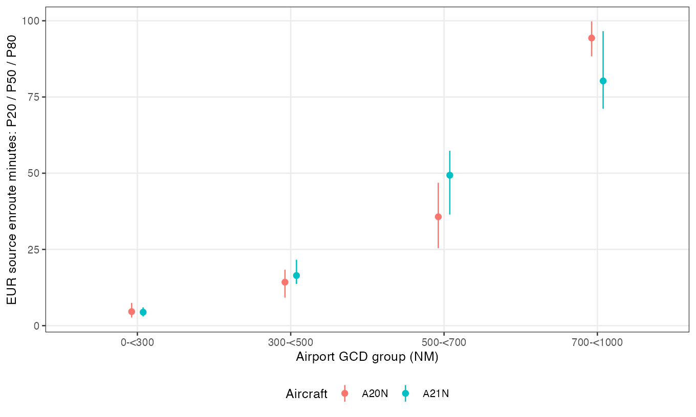

# Descent profiles and enroute fuel references

The batch supports source-specific descent exposure references and five paired
altitude-conditioned enroute kg/NM cells. It also identifies a structural problem
with applying the original continuous/light/heavy rules to short pressure windows.
These results sharpen the proposed lookup without changing source products or
the technical-note manuscript.

## Descent fuel rises with sustained level exposure

For A20N flights over airport GCD 500–<700 NM, FL180–100 descent fuel increases
with total time in source-tagged level segments. These are within-source
associations: CHN and EUR segment detectors are different. The same numerical
exposure bins do not establish a common interruption classification.

| Source | Tagged level time inside window | Fuel n | Fuel P20 / P50 / P80 kg | Median window min |
|---|---|---:|---:|---:|
| CHN | ≤2 min | 115 | 94 / 131 / 160 | 7.21 |
| CHN | >2–5 min | 41 | 161 / 249 / 361 | 10.60 |
| CHN | >5 min | 46 | 327 / 433 / 518 | 14.32 |
| EUR | ≤2 min | 2,480 | 37 / 47 / 71 | 5.60 |
| EUR | >2–5 min | 236 | 157 / 190 / 234 | 10.65 |
| EUR | >5 min | 94 | 297 / 345 / 441 | 15.36 |

The higher-exposure groups have longer traversal times and higher total fuel in
both sources. This supports an exposure gradient, without identifying an abrupt
or optimal breakpoint. EUR fuel already rises across the bins below two minutes.
The two-minute split is a useful working grouping, rather than a universal
threshold estimated from these data.

A21N repeats the pattern: ≤2 versus >2 minutes gives median fuel 146 versus
307 kg in CHN (n=118/227), and 56 versus 242 kg in EUR (n=602/57). The EUR A21N
>5-minute exposure tail has only 14 flights, so its percentiles are suppressed.
Keep a two-minute primary split and an optional five-minute tail rather than
requiring three populated classes for every type.

Interruption count remains useful alongside duration. Among CHN A20N descents,
85 of 202 have multiple ≥20-second source episodes. Of the 46 with more than
five minutes of tagged time, 36 have multiple episodes and 10 have one. A count
threshold alone would miss some sustained exposure. A source tag's absence is
not proof of uninterrupted descent.



## Regional differences depend on the descent window

Conditioning on traversal time does not remove the regional difference uniformly.
In FL180–100, A20N flights in the 600–699 NM GCD band taking 7–<8 minutes have
median fuel 136 kg in CHN and 107 kg in EUR (n=39/33). Their P20–P80 ranges,
114–151 and 76–127 kg, overlap partly. At 6–<7 minutes, medians are 114 and
57 kg (n=36/70), with only a small overlap of their central ranges.

For the lower FL100–075 window, A20N flights in the same GCD band taking 2–<3
minutes have median fuel 26.35 and 22.70 kg (n=82/165). Median times are almost
identical, 2.426 and 2.422 minutes. Their central ranges are 22.69–35.52 and
20.10–25.56 kg. This supports phase-specific references and a closer central
comparison lower down, while retaining the remaining median offset.

The closer 650–<700 NM sensitivity has only 17 EUR A20N observations at 6–<7
minutes and one at 7–<8 minutes; its percentiles are suppressed. Thus the upper
descent comparison above has support at 100-NM resolution, not at every narrower
route-distance restriction. QAR-integrated CHN fuel and modelled EUR fuel remain
confounded with region. The residual difference cannot be attributed to ATM,
aircraft weight, or source method separately.

## Enroute references can now carry an altitude qualifier

The altitude-qualified rows retain the existing common enroute reconstruction
cohort. Classes refer to **time-weighted mean pressure altitude between source
TOC and TOD**, not the maximum flight level or a claim that the whole phase was
flown at a single level. Reconstructed altitude can span long supplied knot gaps.
The residence tables retain that gap context and the alternative level-envelope
boundary scheme. Fuel is used only at its actual source TOC/TOD endpoints.

All five cells below have n≥30 for kg/NM in both sources. Values are individual
flight fuel divided by supplied eligible flown enroute NM, followed by type-7
quantiles. Airport GCD is a grouping variable, not the rate denominator.

| Type | GCD NM | Mean-altitude class | CHN n | CHN kg/NM P20 / P50 / P80 | EUR n | EUR kg/NM P20 / P50 / P80 |
|---|---|---|---:|---:|---:|---:|
| A20N | 600–699 | FL300–339 | 50 | 4.88 / 5.23 / 5.46 | 52 | 4.41 / 4.73 / 5.08 |
| A21N | 500–599 | FL340+ | 71 | 4.55 / 4.84 / 5.21 | 266 | 4.92 / 5.25 / 5.61 |
| A320 | 600–699 | FL300–339 | 78 | 5.55 / 6.00 / 6.39 | 195 | 5.20 / 5.51 / 5.89 |
| A321 | 500–599 | FL300–339 | 39 | 6.00 / 6.25 / 6.40 | 350 | 5.94 / 6.29 / 6.62 |
| A321 | 600–699 | FL300–339 | 115 | 6.38 / 6.56 / 6.86 | 44 | 5.93 / 6.30 / 6.59 |

Every pair has some central-range overlap; the median offsets differ in size and
direction. A321 at 500–599 NM is particularly close. These are descriptive
reference ranges, not a test of equivalence or a justification for replacing
regional rows with a universally calibrated coefficient.

The broad 500–<700 NM A21N/FL300–339 row has n=180/69 for kg/NM, but the
underlying 500–599 cell has n=157/21 and the 600–699 cell n=23/48. Broad pooling
therefore creates paired sample support by mixing different compositions. Retain
the broad reporting bands and these narrower checks together. For A21N/FL340+,
the closer 570–<600 NM check still has n=71/113, with medians 4.84/5.32 kg/NM.



## Evidence for the distance, altitude, and fleet groups

- **Distance groups describe different enroute exposure.** EUR A20N median
  source-enroute time is 4.6, 14.3, 35.7, and 94.3 minutes across 0–<300,
  300–<500, 500–<700, and 700–<1000 NM. The shortest group has a median
  enroute share of about 13%, versus 64% in the longest group. Its enroute
  median is 5.96 kg/NM, compared with 4.52/4.46/4.38 in the longer groups.
  This supports a separate short-sector context, without establishing the
  proposed boundaries as physical discontinuities. Missing CHN groups describe
  the supplied sample, not routes absent from Chinese operations.
- **Altitude remains a useful qualifier.** Within the CHN common A21N cohort,
  median kg/NM declines from 5.68 below FL300 to 5.18 at FL300–339 and 4.84
  at FL340+ (n=98/180/71). EUR's FL300–339 and FL340+ medians are 5.59 and
  5.29 (n=69/594). These are associations across differing route/direction and
  operating mixes; they do not isolate an altitude saving or establish FL340 as
  an optimum.
- **Newer versus older single-aisle is a useful reporting distinction.** At
  600–699 NM and mean altitude FL300–339, A20N median kg/NM is 12.8% below
  A320 within CHN and 14.1% below within EUR. All four samples exceed 30.
  This supports the fleet split while retaining exact type coefficients; it
  does not estimate a controlled engine-technology benefit.
- **Widebodies remain a separate group.** Source-specific fuel/time references
  are available, but no widebody type has paired kg/NM support in the same
  proposed distance group at n≥30. Do not construct that comparison by pooling
  Chinese 500–700 NM operations with European 700–1000 NM operations.

CHN B738 illustrates why total fuel stays alongside rates: median enroute fuel
is 2,356 kg for 500–<700 NM and 4,432 kg for ≥1000 NM, while median kg/NM is
5.95 and 5.46. Fuel counts are 213/652; distance-rate counts are 134/622. These
are independent marginal summaries with different eligible sets, not a single
joint flight vector or an isolated sector-length effect.



## Refine the interruption thresholds before adopting class labels

The original common rule combines a minimum 120-second episode with a ≤20%
level-time limit for the light class. Even its shortest qualifying episode can
meet that share only when the window lasts at least ten minutes. This is a
necessary condition, not sufficient eligibility. Fewer than 1% of either region's
FL100–180 climbs or FL100–075 descents satisfy that duration condition; no
FL075–100 climb does. The near-empty light class therefore partly follows from
the definition, rather than demonstrating a naturally binary operational mix.

For the current finer-window lookup:

- Use **traversal time**, **total tagged level time**, **longest episode**,
  **level share**, and **episode count** as explicit descriptors.
- Keep ≤2, >2–5, and >5 minutes of tagged time as pragmatic exposure bins for
  the source-specific descent exploration. Keep the finer zero, >0–1, and >1–2
  bins available; no tag does not establish a continuous profile.
- Keep a five-minute *traversal* flag for the prior climb exploration. It is
  not the same variable as five minutes of *level time*. In the current CHN
  A20N upper-descent sample, 201 of 202 already traverse in at least five
  minutes, so that traversal cut is uninformative there.
- Retain continuous/light/heavy as proposed common classes, with the existing
  coverage rules, rather than assigning those labels to source-specific bins.
  The primary native-point model has no classifiable CHN FL180–100 descents.
  Its 104 classifiable lower descents are all continuous at the stated scale.
  Common class fuel references remain unpopulated; those facts do not remove
  independently supported marginal, time-conditioned, or altitude references.

The evidence supports phase-specific qualification and exposure gradients. It
does not validate the original 20%/two-episode/180-second combination or prove
that two/five minutes are universal natural breakpoints.

## Populated lookup and remaining slots

`lookup_wide.csv` contains metric-specific n, P20/P50/P80, and mean for fuel kg,
minutes, kg/min, kg/NM, and flown NM. Its key retains source/region, exact type,
reporting fleet group, GCD group, window, and descriptor axis/value. Engine group
is explicitly unstratified. Row metadata retain boundary, fuel, and distance
conventions. Sparse quantiles are suppressed below n=30.

`lookup_exact_enroute_wide.csv` retains the narrower stage checks and their full
metric rows. One immediately usable example is A21N/500–599 NM/enroute/FL340+:

| Source | n for all five metrics | Fuel kg P20 / P50 / P80 | Median min | Median kg/min | kg/NM P20 / P50 / P80 |
|---|---:|---:|---:|---:|---:|
| CHN | 71 | 1,223 / 1,365 / 1,535 | 36.93 | 36.81 | 4.55 / 4.84 / 5.21 |
| EUR | 266 | 1,018 / 1,498 / 1,874 | 38.47 | 39.38 | 4.92 / 5.25 / 5.61 |

Marginal rows span all 24 adopted windows, including both terminal alternatives
and four ground segments. Source-native tagged-time rows are explicitly marked
source-specific and are not flagged as common paired classes. Proposed common
class slots contain missing estimates/support, rather than invented zero counts.
Other descriptor axes overlap in flight membership and must not be summed.

The original offline ground rows omitted GCD_NM, although BAND100 and flight
identity were present. This review joins the existing flight-inventory GCD to
all windows and checks type/distance agreement. Use this review's ground rows
for distance-stratified lookup support, not the original batch's missing-group
ground rows. All marginal metric totals reconcile to the adopted reference view.
No ground distance proxy is introduced: EUR taxi-out and takeoff-roll kg/NM
remain unavailable, and the delivered 0.8 takeoff-roll fuel convention is preserved.

## Reproduce and verify

From the repository root:

```sh
Rscript scripts/21-review-descent-enroute-lookup.R
```

The script verifies the completed offline products and loads the pinned adopted
reference and common-class caches. All 110 base inputs and the common-class
input pins are checked before and after analysis. It checks metric-count
reconciliation, disjoint source segments, conserved clipped level time and
episode counts, lookup-key uniqueness, and sparse percentile suppression.
Flight-level views remain in the ignored restricted derived store; these exports
contain aggregate results. Input, source, and product hash manifests and R session
details accompany the tables. The three PNG figures have been visually checked.
The existing manuscript and its PDF/Word exports are unchanged.
